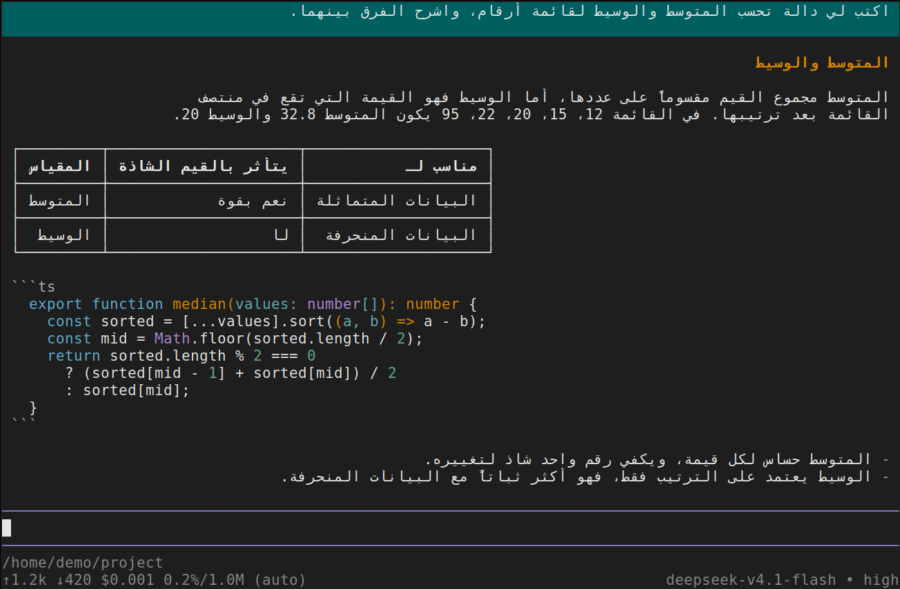

# pi-rtl

Arabic, Persian, Urdu and Hebrew rendering for the [pi](https://pi.dev) coding
agent — on terminals that implement neither bidi reordering nor Arabic shaping
(Windows Terminal, mintty/Git Bash, Kitty, Alacritty, Ghostty, iTerm2).

[العربية](README.ar.md) · English



## The problem

pi writes UTF-8 text with ANSI styling and leaves the layout to the terminal. It
does not run the Unicode Bidirectional Algorithm and does not shape Arabic
letters, and neither do most terminals. What you get:

```
ابحرم            instead of  مرحبا
م ر ح ب ا        disconnected letters
12 ... %         the percent sign detached from its number
```

## Install

```sh
curl -fsSL https://raw.githubusercontent.com/maaune10-netizen/pi-rtl/main/install.sh | sh
```

Restart pi. Re-run the command after every `pi update` — a new release replaces
the bundle.

Other ways in:

```sh
npx -y github:maaune10-netizen/pi-rtl                  # npm < 12
npx -y --allow-git=all github:maaune10-netizen/pi-rtl  # npm 12 blocks git deps by default

git clone https://github.com/maaune10-netizen/pi-rtl
cd pi-rtl
node bin/pi-rtl.mjs            # apply
node bin/pi-rtl.mjs --check    # status
node bin/pi-rtl.mjs --undo     # revert
```

No dependencies, no server, no proxy. What is sent to the model is unchanged —
only what reaches your screen.

### Your font matters

The output uses Arabic presentation forms (U+FB50–FDFF, U+FE70–FEFF), so the
terminal font must contain them:

* ✅ DejaVu Sans Mono, Segoe UI, Arial, Tahoma, Noto Naskh Arabic
* ❌ Consolas, JetBrains Mono, Fira Code, Menlo → you get `□` boxes

Windows Terminal: Settings → Appearance → Font face.
mintty / Git Bash: `Options → Text → Font`.

## How it works

pi composes every output line, then writes it. The patch intercepts that single
call site:

```
normalizeTerminalOutput(line)+reset
  -> __piRtl(normalizeTerminalOutput(line),this.terminal.columns)+reset
```

`rtl.mjs` then, for every line that contains RTL characters:

1. splits the line into per-code-point cells and records the SGR state of each
   cell, so colour and OSC 8 hyperlinks survive the permutation,
2. runs the Unicode Bidirectional Algorithm
   ([`bidi-shaper`](https://github.com/cc1a2b/bidi-shaper), verified against all
   861,948 official UAX #9 conformance cases),
3. converts Arabic letters into their presentation forms (joining),
4. permutes the cells into visual order — a pure permutation, so **the cell
   count never changes** and pi's width, wrapping, overlays and differential
   rendering keep working untouched,
5. re-emits the SGR changes at the new cell positions,
6. treats box-drawing characters and `|` as hard bidi boundaries, the way
   mlterm's `bidi_separators` do, so tables and TUI borders never flip,
7. flushes RTL paragraphs to the right margin, which also puts the caret on the
   correct side while you type Arabic.

Paragraph direction is decided **per segment**, not per line: Arabic-first
segments resolve RTL (like mlterm and macOS Terminal), English-first segments
stay LTR. Lines without RTL characters take a regex fast path and are returned
byte-identical.

## Tests

```sh
node test/run.mjs        # 132 cases
node test/run.mjs -v     # print every case
```

The oracle is `bidi-shaper.render()` applied with the same segment split, so a
failure points at this project's reordering code rather than at the UBA
implementation. Coverage: ordering, numbers and percentages, brackets and
quotes, tables, ANSI spans, alignment, harakat, mixed scripts, real pi lines.

## Uninstall

```sh
node bin/pi-rtl.mjs --undo
```

That is a plain string replacement back to the stock renderer; the patch carries
no runtime state anywhere else.

## Known gaps

* Right alignment is skipped for lines containing wide characters (CJK, emoji),
  because pi's `wcwidth` is not reachable from inside the transform.
* `لا` is drawn as lam-initial + alef-final instead of the single ligature, to
  keep the cell count stable.
* A path immediately after an Arabic word can lose its leading `/` to the RTL
  run (`الملف: home/user/x`). That is what UAX #9 specifies for a neutral slash
  between an RTL and an LTR run; mlterm deviates. Splitting on `/` would break
  `و/أو`.
* Combining marks stay attached to their base (cluster-level reversal), which
  intentionally differs from a naive per-code-point UBA pass.
* Only the standalone pi install (`dist/bundle`) is supported. If pi is loaded
  from `node_modules`, the installer says so and exits instead of pretending.

## Credits

* [`bidi-shaper`](https://github.com/cc1a2b/bidi-shaper) — MIT, vendored in
  `src/vendor/bidi-shaper/`. UAX #9 plus Arabic shaping, zero dependencies.
* [mlterm](https://github.com/arakiken/mlterm) for the separator behaviour.
* The freedesktop
  [BiDi in Terminal Emulators](https://terminal-wg.pages.freedesktop.org/bidi)
  draft, for framing the problem.

## License

MIT
